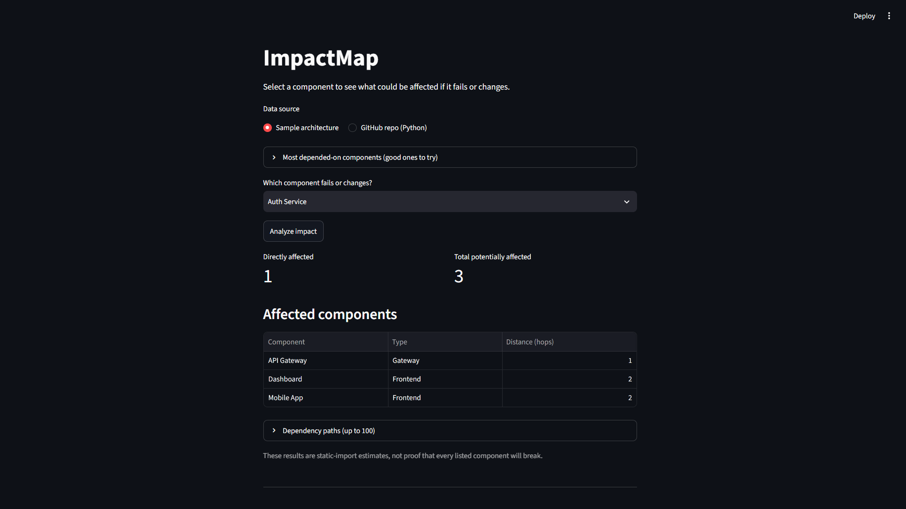
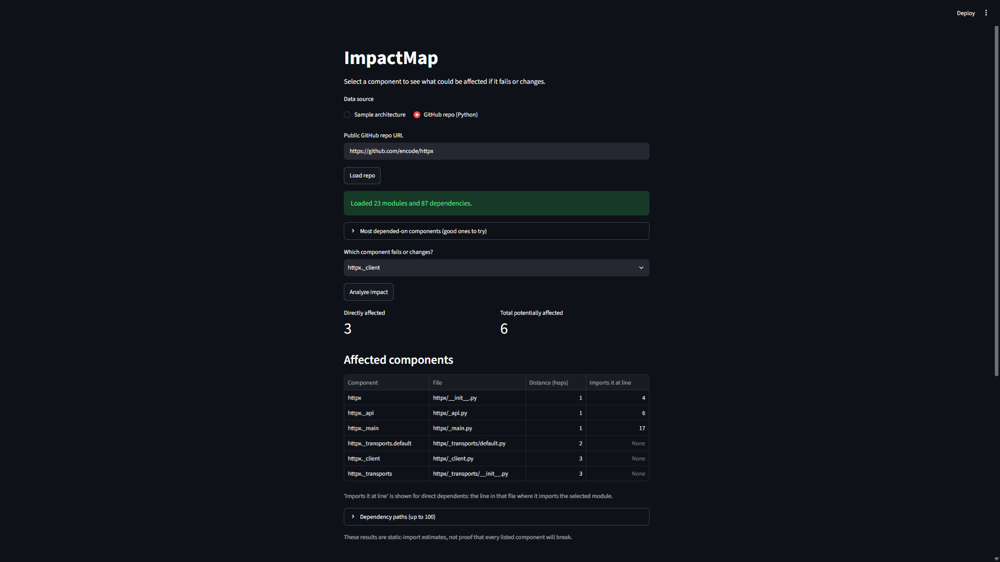
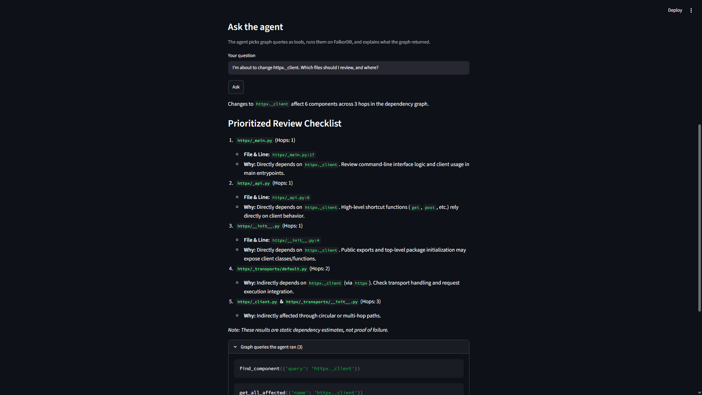
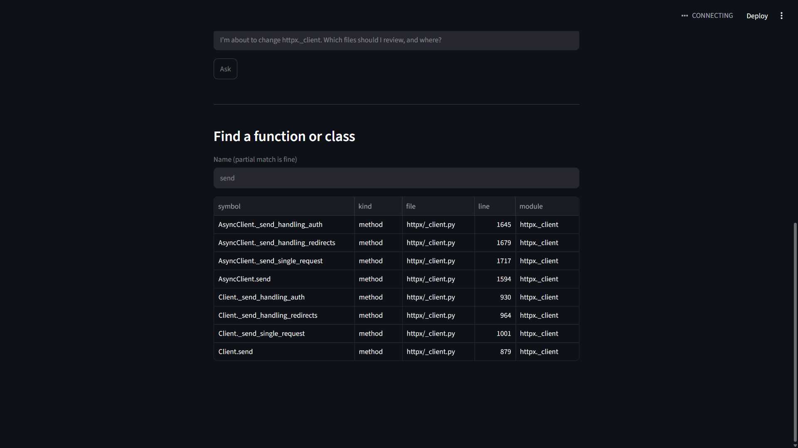

# ImpactMap

**Track:** Agents That Act on Connected Data

ImpactMap answers one question: *if this component fails or changes, what else
could break, and where do I look?* It stores a software system as a graph in
**FalkorDB**, and an agent chooses graph queries as tools to answer questions
about impact.

Two modes:
1. **Sample architecture:** a synthetic system (frontends, services, databases).
2. **GitHub repo analysis:** paste a public Python repo URL. ImpactMap builds the
   file-level import graph and analyzes it, showing each dependent's file path and
   the line where it imports the module. It can also find where a function or
   class is defined.

**Demo video:** (https://youtube.com/shorts/rxlp7AykhQE?feature=share)

**Live demo:** (https://impactmapp.streamlit.app/)

## Why the graph is essential
Every fact in the output (what is affected, how far away, through which path,
which file and line) comes from Cypher queries on FalkorDB. Python fetches and
displays; the LLM only chooses which queries to run and explains the results.
Without FalkorDB there is no analysis. Finding all direct and indirect dependents
is a variable-length traversal, which takes one line of Cypher.

## The agent
The agent receives graph queries as tools and decides which to call and in what
order. Tools (`tools.py`):

| Tool | What it does |
|---|---|
| `find_component` | Search component names; used first when a name may be mistyped |
| `find_symbol` | Find where a function, method or class is defined (file and line); repo graphs only |
| `get_direct_dependents` | Components that depend directly on a component |
| `get_all_affected` | Direct and indirect dependents with hop distance, file, and import line |
| `get_dependency_paths` | Example chains explaining *why* something is affected |
| `get_dependencies_of` | What a component itself depends on (upstream risk) |
| `get_most_depended_on` | The most critical components, ranked |

If a tool receives a wrong name it returns close suggestions, and the agent
retries. The UI lists every graph query the agent ran, so each answer is traceable.

## Graph data model
- **Node:** `(:Component {name, type, description})`
  - Sample graph types: Frontend, Gateway, Service, Database, Cache
  - Repo graph types: Module, Package (`description` holds the file path)
- **Node:** `(:Symbol {name, qualname, kind, path, line})` for each function,
  class and method found in a repo (repo graphs only)
- **Relationship:** `(a)-[:DEPENDS_ON {line}]->(b)` means "a depends on b".
  In repo graphs, `line` is where `a` imports `b`.
- **Relationship:** `(s:Symbol)-[:DEFINED_IN]->(c:Component)` links a symbol to the
  module that defines it
- **Graphs:** `impactmap` (sample) and `repo_<owner>_<repo>` (one per analyzed repo)
- **Indexes:** `Component.name` and `Symbol.name` on repo graphs

Example: `Dashboard -> API Gateway -> Auth Service -> User Database`.
If Auth Service fails, API Gateway, Dashboard and Mobile App are affected, but
User Database is not (Auth Service depends on it, not the reverse).

## Key Cypher queries
Direct dependents:
```cypher
MATCH (a:Component)-[:DEPENDS_ON]->(x:Component {name: $name})
RETURN a.name ORDER BY a.name
```
All affected components with distance and file:
```cypher
MATCH p = (a:Component)-[:DEPENDS_ON*1..10]->(x:Component {name: $name})
RETURN a.name, a.type, a.description, min(length(p)) AS hops
ORDER BY hops, a.name
```
Where each direct dependent imports the module:
```cypher
MATCH (a:Component)-[r:DEPENDS_ON]->(x:Component {name: $name})
RETURN a.name, a.description, r.line ORDER BY a.name
```
Dependency paths:
```cypher
MATCH p = (a:Component)-[:DEPENDS_ON*1..10]->(x:Component {name: $name})
RETURN [n IN nodes(p) | n.name] AS path, length(p) AS hops
ORDER BY hops LIMIT 100
```
What a component depends on:
```cypher
MATCH p = (x:Component {name: $name})-[:DEPENDS_ON*1..3]->(b:Component)
RETURN b.name, b.type, min(length(p)) AS hops ORDER BY hops, b.name LIMIT 40
```
Most depended-on components:
```cypher
MATCH (a:Component)-[:DEPENDS_ON]->(b:Component)
RETURN b.name, count(a) AS n ORDER BY n DESC LIMIT 10
```
Name search:
```cypher
MATCH (c:Component) WHERE toLower(c.name) CONTAINS toLower($q)
RETURN c.name, c.type ORDER BY c.name LIMIT 15
```
Where a function or class is defined:
```cypher
MATCH (s:Symbol)-[:DEFINED_IN]->(c:Component)
WHERE toLower(s.name) CONTAINS toLower($q) OR toLower(s.qualname) CONTAINS toLower($q)
RETURN s.qualname, s.kind, s.path, s.line, c.name ORDER BY s.qualname LIMIT 20
```
Bulk loading (batched):
```cypher
UNWIND $rows AS row
CREATE (:Component {name: row.name, type: row.type, description: row.path})

UNWIND $pairs AS p
MATCH (a:Component {name: p.a}), (b:Component {name: p.b})
CREATE (a)-[:DEPENDS_ON {line: p.line}]->(b)

UNWIND $rows AS row
MATCH (c:Component {name: row.module})
CREATE (:Symbol {name: row.name, qualname: row.qualname, kind: row.kind,
                 path: row.path, line: row.line})-[:DEFINED_IN]->(c)
```

## How repo analysis works
1. Download the repo zip via the GitHub API (public repos only).
2. Parse each `.py` file with Python's `ast` module (no code is executed).
3. Keep only imports that point to other files in the same repo, with line numbers.
4. Collect every function, class and method with its line number, using 'ast'.
5. Load everything into FalkorDB and query it with the Cypher above.

## Architecture
Streamlit UI -> agent (Gemini, function calling) -> graph tools (Python) ->
FalkorDB (Cypher). The UI also runs the same queries directly, without the agent.

## Setup
```bash
git clone https://github.com/Mit217/impactmap
cd impactmap
python -m venv venv
venv\Scripts\activate        # Mac/Linux: source venv/bin/activate
pip install -r requirements.txt
```
1. Create a free FalkorDB instance (FalkorDB Cloud, or Docker:
   `docker run -p 6379:6379 -it --rm falkordb/falkordb:latest`).
2. Get a free Gemini API key from Google AI Studio.
3. Copy `.env.example` to `.env` and fill in the FalkorDB host, port, username,
   password, and `GEMINI_API_KEY`. Set `GEMINI_MODEL` to a model available to
   your key.
4. Load the sample graph: `python load_graph.py`
5. Run: `streamlit run app.py`

The graph analysis works without a Gemini key; only the "Ask the agent" section
needs it. To delete old repo graphs from the database: `python cleanup.py`

## Usage
- **Sample mode:** pick a component and click *Analyze impact*.
- **Repo mode:** paste a public GitHub repo URL, click *Load repo*, then analyze
  any module. Check the "Most depended-on components" list for good starting points.
- **Ask the agent:** ask in plain language, e.g. "I'm about to change the Auth
  Service. What should I review first?"
- **Find a function or class:** search by name in repo mode to get file and line.

## Limitations
- Public Python repos only; file-level dependencies.
- Dynamic imports are not detected; imports under `TYPE_CHECKING` count as dependencies.
- If a file imports the same module several times, only the earliest line is stored.
- Indirect dependents show the file only; the import line applies to direct dependents.
- Symbol search lists top-level functions, classes and methods.         Functions nested
  inside other functions, or defined inside top-level `if`/`try` blocks, are not
  included. It shows where something is defined, not every place it is called.
- Results are static-import estimates, not proof that anything will fail.
- The agent's "what to check" explanations are the model's reasoning about likely
  behavior; only the affected components, distances, paths and locations come
  from the graph.
- Free-tier model limits (about 5 requests per minute) can slow the agent.
- Unauthenticated GitHub API rate limits apply.

## Future work
- Call-level impact analysis (which functions use a changed symbol)
- Other languages and private repositories

## Screenshots





## AI disclosure
I used Claude (Anthropic) as a coding assistant for guidance and code drafts. I
ran, tested and debugged the code, and checked the graph results by hand. At
runtime, the agent uses Google's Gemini API for tool selection and explanations.
